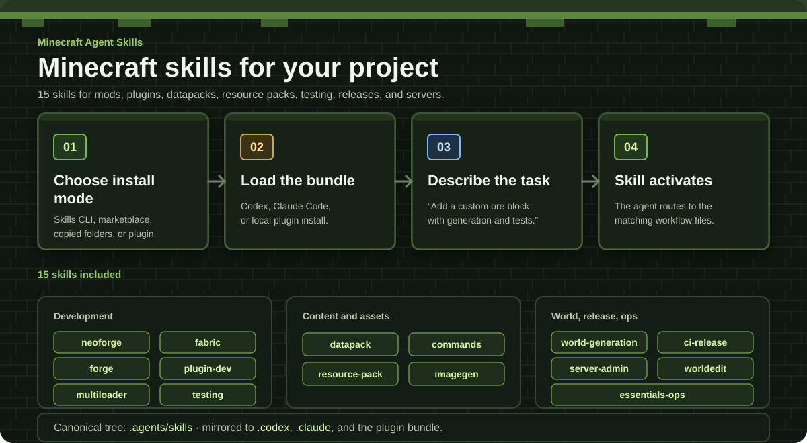

# Minecraft Agent Skills

15 skills for Minecraft mods, plugins, datapacks, art, and server administration.
Supports Minecraft 26.x, with examples for 1.21.x and Forge 1.20.1.
Install the skills with the skills CLI, copy the skill folders, or install the
Codex or Claude Code plugin.

## Install

Install one copy of each skill for the host you use. Preserve unrelated local
skills when a target already exists. Do not copy this repository's `AGENTS.md`
into a Minecraft project. Pick one of the five paths below.

The paths are alternatives. The skills CLI and the manual copy put skill
folders in your project, and the plugin paths load the same skills again, so
using both kinds can expose duplicate skills. `minecraft-imagegen` needs an
image-generation tool supplied by the host or an already connected integration;
installing this bundle or selecting a model does not add that tool.

### 1. Skills CLI

Run this in the root of your Minecraft project:

```bash
bunx skills add julian-perge/minecraft-agent-skills --skill minecraft-neoforge
```

Use `npx skills add` with the same arguments when bun is not installed. Use
`--skill '*'` to install all 15 skills. The folders depend on the agents you
select. In the tested run, the CLI copied each skill into `.agents/skills/`,
linked it into `.claude/skills/` and wrote `skills-lock.json`. Add
`-a claude-code` to install for Claude Code only, and `-y` to skip the
prompts. The same command accepts the path of a local clone instead of
`julian-perge/minecraft-agent-skills`.

### 2. Claude Code marketplace

```bash
claude plugin marketplace add julian-perge/minecraft-agent-skills
claude plugin install minecraft-codex-skills@minecraft-agent-skills
```

### 3. Manual copy

Clone this repository, then copy the skill folders for your host. Copy only
the skills you need if you do not want the whole bundle.

| Host | Copy |
| --- | --- |
| Codex | `.agents/skills/` into the project's `.agents/skills/` |
| Older Codex hosts | `.codex/skills/` only if that host uses the legacy location |
| Claude Code | `.claude/skills/` into the project's `.claude/skills/` |

### 4. Codex plugin

Copy `.agents/plugins/marketplace.json` and `plugins/minecraft-codex-skills/`
under the same project root, open the plugins surface, and install
`minecraft-codex-skills`.

### 5. Claude Code plugin folder

From a clone of this repository, run:

```bash
claude --plugin-dir ./plugins/minecraft-codex-skills
```

<!-- markdownlint-disable MD033 -->
<p align="center">
  
</p>
<!-- markdownlint-enable MD033 -->

## Optional MCP server

The skills work without an MCP server. `minecraft-neoforge` uses one for
source, mapping and registry lookups, and those lookups are weaker without it.
For stronger lookups, add
[`adhi-jp/minecraft-modding-mcp`](https://github.com/adhi-jp/minecraft-modding-mcp)
(npm package `@adhisang/minecraft-modding-mcp`). It needs Node.js 22.13 or
newer, and Java 17 or newer for its decompile and remap tools. Its registry
tools need the Java version of the target Minecraft release.

For Claude Code, register it with one of these runners. They register the
server for you in the current project only. Add `-s project` to write the
project's `.mcp.json` instead.

```bash
claude mcp add minecraft-modding -- bunx @adhisang/minecraft-modding-mcp
claude mcp add minecraft-modding -- npx -y @adhisang/minecraft-modding-mcp
```

For a global install, install the package once, then register its command:

```bash
bun add -g @adhisang/minecraft-modding-mcp
claude mcp add minecraft-modding -- minecraft-modding-mcp
```

To share the server with a project, put one of these in the project's
`.mcp.json` instead. With `bunx`:

```json
{
  "mcpServers": {
    "minecraft-modding": {
      "command": "bunx",
      "args": [
        "@adhisang/minecraft-modding-mcp"
      ]
    }
  }
}
```

With `npx`:

```json
{
  "mcpServers": {
    "minecraft-modding": {
      "command": "npx",
      "args": [
        "-y",
        "@adhisang/minecraft-modding-mcp"
      ]
    }
  }
}
```

With a global install:

```json
{
  "mcpServers": {
    "minecraft-modding": {
      "command": "minecraft-modding-mcp",
      "args": []
    }
  }
}
```

For Codex, run:

```bash
codex mcp add minecraft-modding -- npx -y @adhisang/minecraft-modding-mcp
```

## Skills

| Skill | Use it for |
| --- | --- |
| `minecraft-neoforge` | NeoForge mods for 1.21.1, 1.21.11, 26.1.2, and 26.3 |
| `minecraft-fabric` | Fabric mods for 26.x and 1.21.x |
| `minecraft-forge` | Forge 1.20.1 mods |
| `minecraft-plugin-dev` | Paper, Bukkit, and Spigot plugins |
| `minecraft-datapack` | Vanilla datapacks, functions, loot, and advancements |
| `minecraft-commands-scripting` | Commands, scoreboards, NBT, and RCON scripting |
| `minecraft-multiloader` | Architectury projects targeting NeoForge and Fabric |
| `minecraft-testing` | JUnit, MockBukkit, and GameTests |
| `minecraft-ci-release` | GitHub Actions and Modrinth/CurseForge releases |
| `minecraft-world-generation` | Biomes, dimensions, structures, and features |
| `minecraft-resource-pack` | Textures, models, sounds, fonts, and shaders |
| `minecraft-imagegen` | Pack art, concepts, thumbnails, and UI mockups |
| `minecraft-server-admin` | Hosting, tuning, backups, proxies, and operations |
| `minecraft-worldedit-ops` | Safe WorldEdit selections, schematics, and brushes |
| `minecraft-essentials-ops` | EssentialsX configuration, moderation, and economy |

## Usage

Describe the task and Minecraft version. For example:

- "Fix this Paper 1.21.11 command without upgrading the server."
- "Add a 26.3 datapack recipe and verify its files."
- "Review this Velocity configuration and suggest changes."

The agent reads the relevant skill and uses your project's version settings.
Choose your model and tools in Codex or Claude Code. The skills do not pin model
IDs or reasoning settings.

Bundled validators check file structure and common mistakes. Test builds and
in-game behavior in your Minecraft project.
Reviewed against Minecraft 26.3 / Java 25 on October 29, 2026. See the
[review notes](docs/skill-audit-2026-10.md) for sources and validation limits.

## Maintaining the bundle

Use Node 22 or newer, Bun 1.4.4 or newer, and Bash (Git Bash works on Windows). Edit
`.agents/skills/`, then run:

```bash
bun run sync:skills
bun run check
```

The sync command refreshes `.codex/skills/`, `.claude/skills/`, and the plugin
bundle. The copied skill directories do not need the repository's Node tooling.

## License

[MIT](LICENSE)
